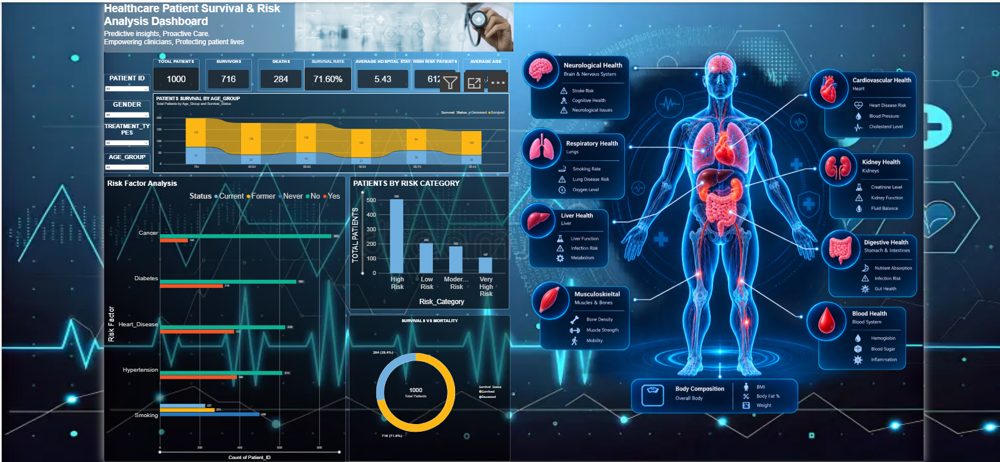

# 🏥 Healthcare Patient Survival & Risk Analytics Dashboard

📊 End-to-end healthcare analytics dashboard using **Power BI, Power Query, and DAX**.

## 📌 Project Overview
- Analyzed 1,000 synthetic, anonymized patient records covering survival outcomes, demographics, risk factors, and treatments.
- Cleaned and transformed the data in Power Query and modeled it for reporting.
- Created 7 KPIs: Total Patients, Survivors, Deaths, Survival Rate, Average Hospital Stay, High-Risk Patients, and Average Age.
- Built interactive slicers for Gender, Age Group, Treatment Type, and Patient ID, with cross-filtering across all visuals.
- Overall survival rate in the dataset: **71.6%**.

## 📸 Dashboard Preview

🎥 Demo video: [add your LinkedIn or YouTube link here]

## 📊 What the Dashboard Shows
- **Survival vs mortality** for the full dataset and for any selected patient group
- **Patient survival by age group**
- **Risk factor analysis** for cancer, diabetes, heart disease, hypertension, and smoking
- **Patients by risk category**

## 🛠️ Tech Stack
- Power BI Desktop
- Power Query
- DAX
- Microsoft Excel (data source)

## 📂 Repository Contents
- `healthcare_patient_survival.pbix`: the Power BI report
- `healthcare_patient_data.xlsx`: the synthetic dataset
- `healthcare_measures.dax.txt`: the DAX measures used in the report
- `dashboard_preview.png`: dashboard screenshot

## ⚠️ Note
The data is synthetic and for learning purposes only. The dashboard describes patterns in this dataset and does not support clinical conclusions.

## 🚀 How to Open
1. Download the `.pbix` file.
2. Open it in Power BI Desktop (free from Microsoft).

## 👤 Author
**Rahul Diwakar** | [LinkedIn](https://www.linkedin.com/in/rahul-diwakar-645197205) | [GitHub](https://github.com/RahulDiwakar09)
